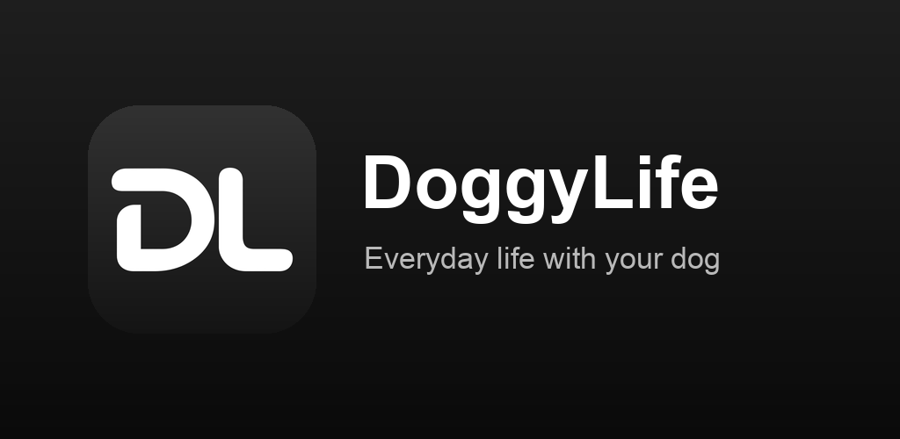
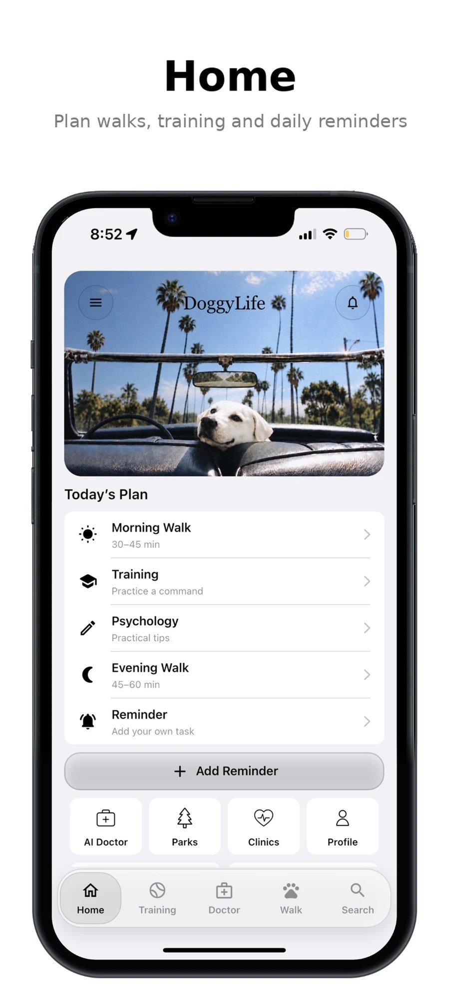
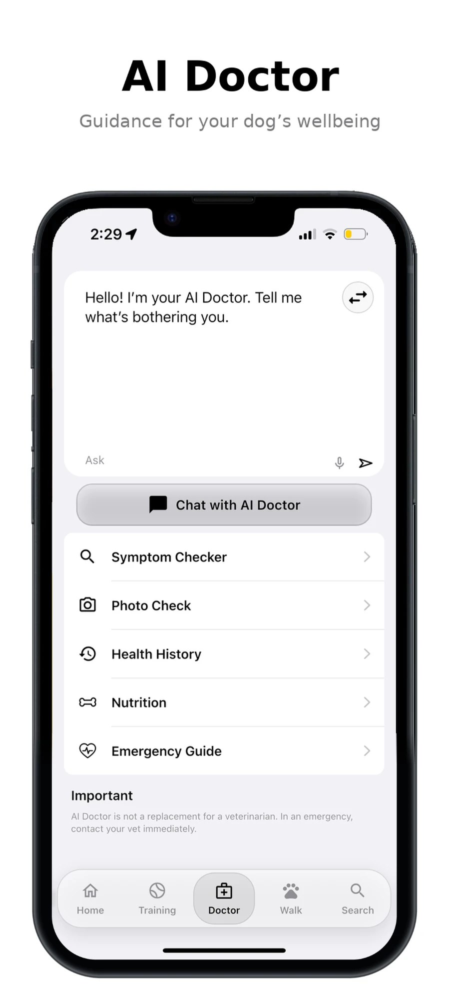
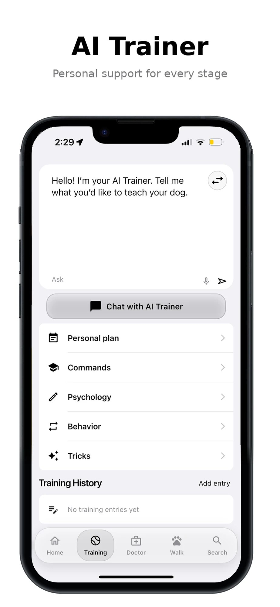
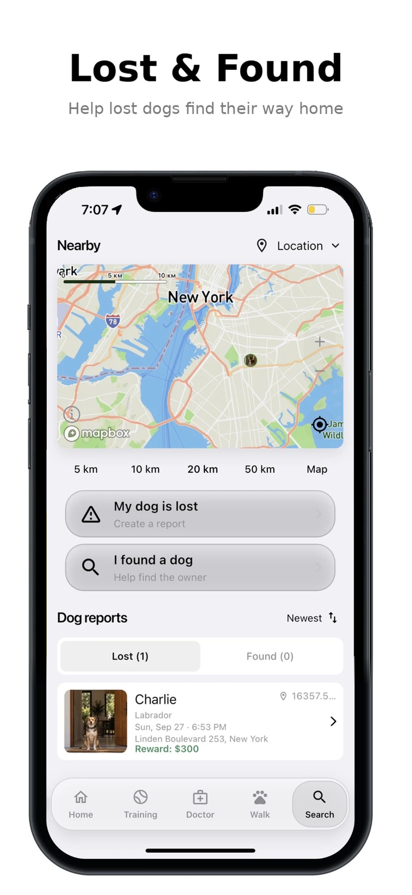
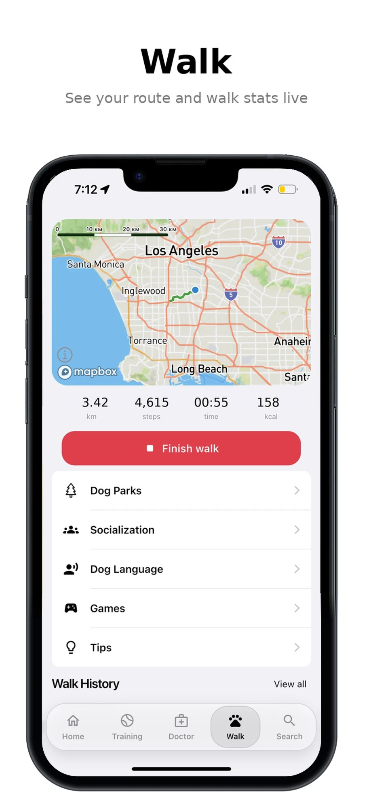
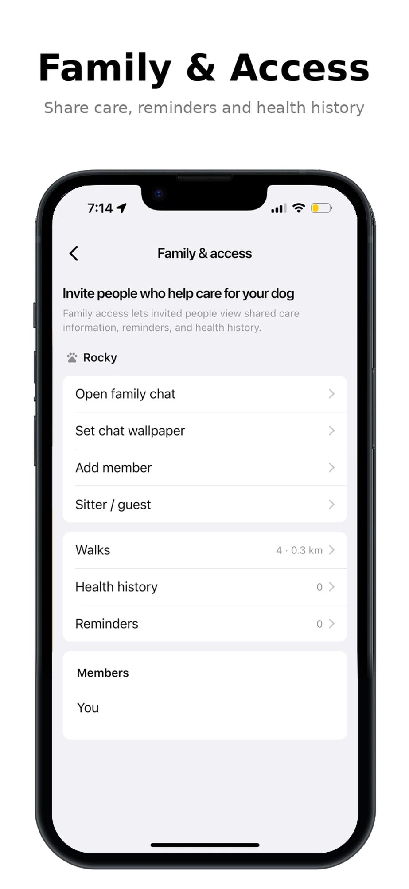

# DoggyLife

**[Download on the App Store](https://apps.apple.com/app/id6820760584)** · **[Get it on Google Play](https://play.google.com/store/apps/details?id=app.doggylife.doggy_life)**

A care app for dog owners. The source code is private; this page shows what the app does and how it is built.

**iOS:** live on the [App Store](https://apps.apple.com/app/id6820760584), 19 languages.
**Android:** live on [Google Play](https://play.google.com/store/apps/details?id=app.doggylife.doggy_life), 178 countries, 19 languages.

## What it does

- Dog profile and health records, weight, reminders
- Walks with a route on the map
- AI assistant for questions about the dog
- Family chat and sitter access
- Lost and found board with nearby vet clinics and dog parks
- Collar QR code with a public page for the owner's chosen details
- Travel with your dog: send a request for a flight, import or paperwork and get connected with a partner company

## How it is built

| Layer | Technology |
|---|---|
| App | Flutter (Dart), iOS and Android |
| Backend | FastAPI (Python) on Google Cloud Run |
| Data and auth | Supabase (PostgreSQL, authentication, file storage) |
| Notifications | Firebase Cloud Messaging |
| Maps | Mapbox |
| AI | Integration with several AI models |
| Payments | In-app subscriptions with server-side purchase verification |

## Screenshots

  
  
  

  
  
  

## Contact

Igor Mosur · https://appflow-dev.web.app
